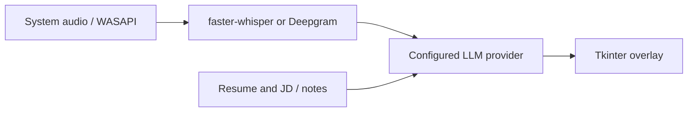

# Echoprep

A Windows desktop app that turns system audio into streamed practice-interview answers in an always-on-top Tkinter overlay, with optional resume context.

Built for mock interviews and practice. Check the rules of any real interview before using AI assistance.

## Features

- WASAPI loopback capture from the default Windows playback device.
- Local faster-whisper transcription or optional Deepgram streaming transcription.
- Streamed answers through configurable Groq, Gemini, or local Ollama endpoints.
- Resume and job-description context from PDF, DOCX, or text files.
- AUTO and MANUAL modes, Answer Now, Regenerate, Copy, and Clear controls.
- Global hotkeys, adjustable opacity, and saved window settings.

## Architecture



Whisper runs locally on CPU with int8 computation. Audio is converted to 16 kHz mono. Worker threads pass updates to the Tkinter event queue. Cloud LLM requests include the transcript, loaded resume/notes, and up to three previous question/answer pairs. Deepgram mode also sends captured audio to Deepgram.

## Tech stack

Python, Tkinter, NumPy, PyAudioWPatch, faster-whisper, the OpenAI-compatible Python client, websocket-client, pypdf, python-docx, and keyboard. PyInstaller is optional for executable packaging.

## Project structure

```text
.
|-- README.md
|-- LICENSE
|-- .gitignore
|-- .env.example
|-- run.bat                  # Creates root venv and launches app
|-- build_exe.bat            # Optional PyInstaller build
`-- interview-copilot/
    |-- app.py              # Overlay and pipeline coordination
    |-- audio.py            # WASAPI capture and resampling
    |-- config.py           # Providers, models, segmentation, hotkeys
    |-- llm.py              # Prompt context and streamed answers
    |-- resume.py           # Document text extraction
    |-- settings.py         # Local settings persistence
    |-- stt_deepgram.py      # Optional streaming STT
    |-- requirements.txt
    |-- test_logic.py
    `-- README.md
```

## Windows setup

Install Python 3.10 or newer with Tkinter and add Python to PATH. Use Windows with a working default playback device. Internet access is needed for dependency installation, the first Whisper model download, and cloud providers.

From the repository root in **Command Prompt**:

```bat
python -m venv venv
venv\Scripts\activate
python -m pip install -r interview-copilot\requirements.txt
setx LLM_API_KEY "your_key_here"
```

The value above is a placeholder. Set your credential privately in your local environment; never put it in source files. `setx` affects newly opened processes. Close the terminal, open a new Command Prompt in the repository root, then run:

```bat
venv\Scripts\activate
cd interview-copilot
python app.py
```

Edit `interview-copilot/config.py` to select a provider and model supported by your account. The existing default is Gemini with `gemini-2.5-flash`. Model availability and provider quotas vary; the configured Groq model may need updating.

Alternatively, double-click `run.bat`. It creates the root `venv/`, installs requirements if needed, and launches without a console. It requires `LLM_API_KEY` even when Ollama is selected; use the manual launch for local Ollama. Ollama must be running with the configured model installed.

For optional Deepgram, set `DEEPGRAM_API_KEY` privately in the environment, reopen the terminal, and change `STT_PROVIDER` to `"deepgram"`.

`.env.example` documents variable names only. The app does **not** load `.env` files automatically. Never commit credentials, personal documents, settings, recordings, or logs.

## Usage

1. Click **Resume** to select a PDF, DOCX, or TXT resume.
2. Optionally click **JD/Notes** to select a job description or preparation notes.
3. Play practice-question audio through the Windows default output device, then click **Start**. Loopback captures playback, not the microphone directly.
4. In **AUTO**, answers start after detected speech segments. In **MANUAL**, use **Answer Now** to submit the recent transcript buffer.
5. Use **Regenerate** to request a shorter/different answer, **Copy** for clipboard output, and **Clear** to clear the visible answer and transcript buffer.
6. Click **Stop** to stop audio capture. Close the app when finished.

Use **?** for the hotkey guide: Ctrl+Alt+A answers, C clears, M changes mode, S starts/stops, H shows/hides, and Up/Down changes opacity. Ctrl+L also clears. Clear does not erase the LLM conversation history; restart the app for a fresh session.

Window geometry, opacity, mode, and resume/notes paths are saved in ignored `interview-copilot/settings.json`. Keep personal documents outside the repository or in ignored `private/` or `resumes/` folders. Loading a document does not copy it into the repository.

## Configuration

Settings live in `interview-copilot/config.py`; defaults below describe the existing implementation.

| Option | Default | Purpose |
|---|---|---|
| `PROVIDER` | `gemini` | Select `groq`, `gemini`, or `ollama` |
| `PROVIDERS` | Provider URL/model mapping | Set the endpoint and model for each provider |
| `API_KEY` | `LLM_API_KEY` environment variable | Cloud LLM credential; never hardcode |
| `STT_PROVIDER` | `whisper` | Local Whisper or cloud `deepgram` |
| `WHISPER_MODEL` | `base.en` | Whisper model; larger models use more resources |
| `LANGUAGE` | `en` | Whisper transcription language |
| `DEEPGRAM_API_KEY` | Environment variable | Optional Deepgram credential |
| `SILENCE_THRESHOLD` | `0.008` | RMS threshold; raise for noise, lower for quiet speech |
| `END_SILENCE_SEC` | `0.9` | Silence ending a Whisper segment |
| `MIN_SPEECH_SEC` | `0.6` | Minimum speech duration for Whisper processing |
| `MAX_SEGMENT_SEC` | `20` | Speech-duration limit triggering Whisper processing |
| `BUFFER_MAX_SEC` | `60` | Recent transcript window for manual answers |
| `ANSWER_STYLE` | 3?5 bullets, about 90 words, STAR for behavioral questions | Prompt instruction, not a guaranteed output limit |
| `HOTKEYS` | Ctrl+Alt combinations | Global control bindings |
| `HOTKEY_HELP` | Displayed shortcut text | Update alongside custom hotkeys |

Deepgram currently uses fixed English `nova-2` settings in `stt_deepgram.py`; Whisper segmentation options do not configure Deepgram endpointing.

## Troubleshooting

| Symptom | Check |
|---|---|
| No audio / loopback device error | Confirm Windows default playback device, play audio through it, and restart capture after changing devices |
| Missing API key | Reopen the terminal after setting the environment variable; confirm the provider matches the credential |
| Model, authentication, or rate-limit error | Check the configured provider/model and your account access or quota |
| First start is slow | Allow the Whisper model download to finish; check connectivity and disk space |
| False triggers or missed speech | Adjust silence threshold and segment timings; reduce playback noise |
| Missing module | Activate the intended venv and install the requirements with its Python interpreter |
| Hotkeys do not respond | Check conflicting shortcuts or Windows permission differences; use the overlay buttons |
| Resume appears empty | Scanned PDFs require OCR elsewhere; this app extracts embedded text only |
| Launcher closes or hides errors | Run `python app.py` from the activated environment to see diagnostics |

## Limitations and privacy

- Windows WASAPI is required. Other operating systems are not supported by this capture implementation.
- Transcription and generated answers can be inaccurate; review output during practice.
- CPU speed, model size, network latency, and provider limits affect response time.
- Whisper ignores transcripts shorter than three words. Resume and notes context are truncated to 12,000 and 8,000 characters respectively.
- The overlay is always on top; it is not guaranteed to be hidden from screen sharing or recording.
- Stop halts capture but does not cancel an in-flight LLM response. The current Stop path does not explicitly close the Deepgram connection; exit the app to end that session.
- Cloud providers receive the data described in Architecture. Only load documents and capture audio you are authorized to process.
- Dependencies are unpinned; installation is minimal but not a reproducible dependency lock.

## Validation and optional packaging

From the app directory, run `python test_logic.py` for the existing non-audio checks. These do not exercise live capture, provider calls, or the GUI.

After preparing the root venv, `build_exe.bat` installs PyInstaller and builds `dist/InterviewCopilot/InterviewCopilot.exe`. Distribute the complete generated directory only after checking it for private data; build outputs are ignored by Git.

Screenshots: add images in /docs

## License

MIT. Copyright (c) 2026 Chirag Sharma. See [LICENSE](LICENSE).
